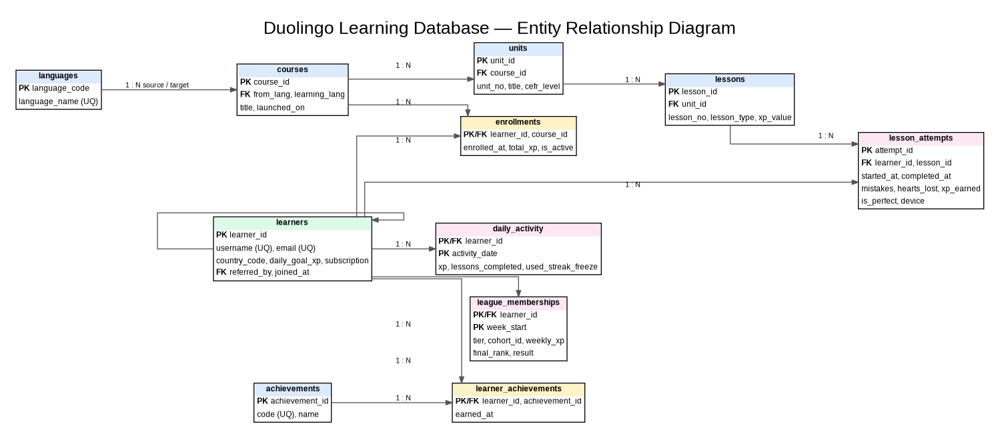

# Phase 2 — Schema design and data loading

I used the column names and values in the CSV files to make the tables. There are 11 files. The data has 10 languages, 11 courses, 220 units, 1,760 lessons, 30,000 learners, 37,500 enrollments, 188,300 lesson attempts, 189,109 daily activity rows, 28,598 league entries, 10 achievements and 38,860 learner achievements.

IDs use `integer`, except `attempt_id`, which uses `bigint`. Dates use `date`; timestamps with a time-zone offset use `timestamptz`; yes/no values use `boolean`. I used `smallint` for small counts and `varchar` for short codes and labels.

## Tables and columns

| Table | Column | Type | Key or rule |
|---|---|---|---|
| languages | language_code | varchar(2) | PK; two lowercase letters |
| languages | language_name | varchar(40) | Required and unique |
| courses | course_id | integer | PK |
| courses | from_lang | varchar(2) | Required; FK to languages |
| courses | learning_lang | varchar(2) | Required; FK to languages; different from `from_lang` |
| courses | title | varchar(120) | Required |
| courses | launched_on | date | Required |
| units | unit_id | integer | PK |
| units | course_id | integer | Required; FK to courses |
| units | unit_no | smallint | Required; positive; unique in its course |
| units | title | varchar(100) | Required |
| units | cefr_level | varchar(2) | Required; A1, A2, B1, B2 or C1 |
| lessons | lesson_id | integer | PK |
| lessons | unit_id | integer | Required; FK to units |
| lessons | lesson_no | smallint | Required; positive; unique in its unit |
| lessons | lesson_type | varchar(12) | Required; LEARN, PRACTICE, STORY or LEGENDARY |
| lessons | xp_value | smallint | Required; zero or more |
| learners | learner_id | integer | PK |
| learners | username | varchar(40) | Required, unique; letters, numbers and underscore |
| learners | email | varchar(254) | Required and unique |
| learners | country_code | varchar(2) | Required; two uppercase letters |
| learners | daily_goal_xp | smallint | Required; 10, 20, 30 or 50 |
| learners | subscription | varchar(8) | Required; FREE, SUPER or MAX |
| learners | referred_by | integer | Optional self-reference to learners; set to NULL if referrer is deleted |
| learners | joined_at | timestamptz | Required |
| enrollments | learner_id | integer | Part of PK; FK to learners; delete with learner |
| enrollments | course_id | integer | Part of PK; FK to courses |
| enrollments | enrolled_at | timestamptz | Required |
| enrollments | total_xp | integer | Required; zero or more; stored total |
| enrollments | is_active | boolean | Required |
| lesson_attempts | attempt_id | bigint | PK |
| lesson_attempts | learner_id | integer | Required; FK to learners; delete with learner |
| lesson_attempts | lesson_id | integer | Required; FK to lessons |
| lesson_attempts | started_at | timestamptz | Required |
| lesson_attempts | completed_at | timestamptz | Optional; blank for unfinished attempts |
| lesson_attempts | mistakes | smallint | Required; zero or more |
| lesson_attempts | hearts_lost | smallint | Required; zero or more, no more than mistakes |
| lesson_attempts | xp_earned | smallint | Required; zero or more; unfinished attempts earn zero |
| lesson_attempts | is_perfect | boolean | Required; a perfect attempt has no mistakes |
| lesson_attempts | device | varchar(7) | Required; ANDROID, IOS or WEB |
| daily_activity | learner_id | integer | Part of PK; FK to learners; delete with learner |
| daily_activity | activity_date | date | Part of PK |
| daily_activity | xp | integer | Required; zero or more |
| daily_activity | lessons_completed | smallint | Required; zero or more |
| daily_activity | used_streak_freeze | boolean | Required; freeze day has zero XP in the data |
| league_memberships | learner_id | integer | Part of PK; FK to learners; delete with learner |
| league_memberships | week_start | date | Part of PK; must be Monday |
| league_memberships | tier | varchar(10) | Required; one of eight league tiers |
| league_memberships | cohort_id | integer | Required |
| league_memberships | weekly_xp | integer | Required; zero or more |
| league_memberships | final_rank | smallint | Optional; from 1 to 30 |
| league_memberships | result | varchar(8) | Optional; PROMOTED, DEMOTED or STAYED; paired with rank |
| achievements | achievement_id | integer | PK |
| achievements | code | varchar(40) | Required and unique |
| achievements | name | varchar(80) | Required |
| learner_achievements | learner_id | integer | Part of PK; FK to learners; delete with learner |
| learner_achievements | achievement_id | integer | Part of PK; FK to achievements |
| learner_achievements | earned_at | timestamptz | Required |

## Relationships

A language can be used in many courses as the source or learning language. A course has many units, and a unit has many lessons. A learner can enroll in many courses, and each course can have many learners; `enrollments` connects them. Learners can earn many achievements, and each achievement can belong to many learners; `learner_achievements` connects those tables. Lesson attempts, daily activity and league rows each belong to one learner. Learners can refer other learners through `referred_by`.

When a learner is deleted, their enrollments, attempts and activity rows are deleted too. If a referrer is deleted, the referral field is cleared. Courses, languages and lessons that are still being referenced are kept so that course and attempt records are not accidentally removed.

## Checks and empty values

The schema has checks for valid codes, subscription plans and lesson types; positive unit and lesson numbers; nonnegative XP and mistake counts; hearts not exceeding mistakes; and timestamps in the right order. It also checks that a learner does not refer to themselves, unfinished attempts have no XP, freeze days have zero XP, league weeks start on Monday, and rank and result are either both set or both empty.

Some checks need more than one table, so they are not `CHECK` constraints. For example, checking that a learner is enrolled in the course for a lesson attempt needs the enrollment, lesson and unit tables.

The blank values in the files have a reason:

- `referred_by` is empty for 21,102 learners because they have no recorded referrer.
- `completed_at` is empty for 21,574 attempts that were not finished. They earned no XP.
- `final_rank` and `result` are both empty for 847 league rows from the week starting 2026-06-29. That week was still open in the export.

## Functional dependencies and normalization

Each table's other columns depend on its primary key. The unique columns shown below are candidate keys too, so these tables are in 3NF/BCNF.

| Table | Functional dependency |
|---|---|
| languages | `language_code → language_name`; `language_name → language_code` |
| courses | `course_id → all other columns`; `(from_lang, learning_lang) → course_id, title, launched_on` |
| units | `unit_id → all other columns`; `(course_id, unit_no) → unit_id, title, cefr_level` |
| lessons | `lesson_id → all other columns`; `(unit_id, lesson_no) → lesson_id, lesson_type, xp_value` |
| learners | `learner_id → all other columns`; `username → all other columns`; `email → all other columns` |
| enrollments | `(learner_id, course_id) → enrolled_at, total_xp, is_active` |
| lesson_attempts | `attempt_id → all other columns` |
| daily_activity | `(learner_id, activity_date) → xp, lessons_completed, used_streak_freeze` |
| league_memberships | `(learner_id, week_start) → tier, cohort_id, weekly_xp, final_rank, result` |
| achievements | `achievement_id → code, name`; `code → achievement_id, name` |
| learner_achievements | `(learner_id, achievement_id) → earned_at` |

`is_perfect` can be inferred from mistakes, but I kept it because it is in the file and used by a query. Daily XP, enrollment XP and weekly league XP are stored totals. They repeat information from attempts, but make the supplied queries easier to run. The application would need to keep these totals up to date.

## Loading and checks

Run `sql/01_schema.sql`, then `sql/02_load_data.sql` from the project folder after extracting `seed_data.zip`. The load file inserts parent tables before child tables. It also runs `ANALYZE` and prints the row counts.

| Table | Rows in seed data |
|---|---:|
| languages | 10 |
| courses | 11 |
| units | 220 |
| lessons | 1,760 |
| learners | 30,000 |
| enrollments | 37,500 |
| lesson_attempts | 188,300 |
| daily_activity | 189,109 |
| league_memberships | 28,598 |
| achievements | 10 |
| learner_achievements | 38,860 |

I checked these rules against the CSV files:

- Every lesson attempt belongs to a course the learner is enrolled in: **0 missing enrollments**.
- Daily XP matches the learner's completed attempt XP for that date: **0 mismatches**.
- No league cohort has more than 30 learners: **0 oversized cohorts**; largest cohort has 30.
- League rank and result are either both present or both empty: **0 mismatches**.

These results come from checking the CSV data. I have not loaded the files into PostgreSQL here. No extra indexes are added in this phase; PostgreSQL will create indexes for primary and unique keys automatically.

I did not find a problem in the four checks above. The stored totals can still drift later if the application does not update them when lesson activity changes.
